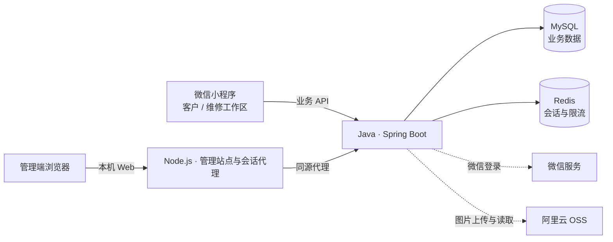

<div align="center">

# 安心家电修 · FixMate

**面向家电维修服务的报修、派单与工单管理系统**


[功能概览](#功能概览) · [技术栈](#技术栈) · [快速启动](#快速启动) · [小程序调试](#小程序调试)

</div>

## 功能概览

安心家电修把家电报修、平台受理、师傅接单、预约、报价和完工验收串在同一张工单里。客户与维修人员使用同一个微信小程序，平台使用独立的 Web 管理端。

| 工作区 | 主要功能 |
| --- | --- |
| 小程序 · 客户 | 发起报修、安全筛查、选择上门时段、申请改约、确认报价、验收或提出返修问题 |
| 小程序 · 维修人员 | 通过邀请申请维修身份，处理定向派单或大厅接单、预约、现场检测、报价和完工 |
| Web · 管理端 | 核对报修、协调安全事件和派单、处理报价审批、维护员工与价目、查询操作审计 |

普通工单从客户提交开始，由平台核对并安排服务，师傅接单和确认预约后提交检测与报价，客户确认后继续维修，最后确认验收。安全阻断、报价过期、取消和返修均有对应的状态和处理入口。

## 系统架构



Compose 启动 Web 管理端、Java 后端、MySQL 和 Redis。微信开发者工具在宿主机运行，登录和图片功能使用接收方配置的外部服务。

## 技术栈

| 层级 | 技术 | 用途 |
| --- | --- | --- |
| 小程序 | 微信原生小程序、TypeScript、WXML、WXSS、Vant Weapp | 客户和维修人员界面 |
| Web 管理端 | TypeScript、HTML、CSS、Node.js 22 | 管理界面、静态文件服务和同源会话代理 |
| 后端 | Java 21、Spring Boot 3.5、Spring Security、MyBatis-Plus、Maven | 业务接口、权限校验、状态流转和数据库访问 |
| 数据与存储 | MySQL 8.0、Redis 7.4、Flyway、阿里云 OSS | 业务数据、会话状态、迁移和图片存储 |
| 接口与运行 | OpenAPI 3.0、TypeScript 契约模型、Docker Compose | 前后端协议和本地容器环境 |

## 快速启动

以下命令以 Windows PowerShell 为例。下载源码或克隆仓库后，进入直接包含 `compose.yaml` 的目录。先启动 Docker Desktop，使用 Linux 容器。首次构建需要联网。

### 1. 初始化并启动

```powershell
powershell -ExecutionPolicy Bypass -File .\scripts\init-docker-env.ps1
docker compose up -d --build --wait --wait-timeout 300
docker compose ps
```

初始化脚本会创建本机 `.env`，生成 MySQL、Redis 和 JWT 所需的凭据。重复运行时会使用已有配置。预期 `mysql`、`redis`、`backend`、`admin` 均为 `healthy`，Flyway 随后端启动自动应用迁移。

| 服务 | 地址 |
| --- | --- |
| Web 管理端 | [127.0.0.1:5173](http://127.0.0.1:5173/) |
| 后端健康检查 | [127.0.0.1:8080/actuator/health](http://127.0.0.1:8080/actuator/health)，预期返回 `UP` |

### 2. 首次创建管理员

新数据库只需执行一次。直接在 PowerShell 中运行，按提示输入用户名、显示名和两次六位数字初始密码。

```powershell
docker compose exec backend java '-Dfile.encoding=UTF-8' -jar /app/fixmate.jar --server.port=-1 --fixmate.bootstrap-admin.enabled=true --fixmate.bootstrap-admin.mode=create
```

看到 `Admin credentials saved` 后，打开管理端登录并按提示改密。打开「运营工作台」和「工单中心」确认页面能读取数据。新环境的工单列表初始为空。

### 3. 日常启停

```powershell
docker compose up -d --wait
docker compose down
```

第一条启动已有服务，第二条停止服务。MySQL、Redis 和管理端会话密钥由 Docker 卷保存，下次可继续使用原 `.env` 和管理员账号。

## 小程序调试

运行 Web 管理端只需要 Docker。调试小程序还需要本机安装 **Node.js** 和 **微信开发者工具**，并准备可调试的小程序 AppID。

1. 将 `miniapp-user/project.config.json` 的 `appid` 改为自己的 AppID，或在导入项目时选择你有调试权限的 AppID。
2. 在根目录的本地 `.env` 填写对应的 `WECHAT_APP_ID` 和 `WECHAT_APP_SECRET`。需要真实图片上传时同时配置 `ALIYUN_OSS_ENDPOINT`、`ALIYUN_OSS_BUCKET`、`ALIYUN_OSS_ACCESS_KEY_ID` 和 `ALIYUN_OSS_ACCESS_KEY_SECRET`。保存后在根目录执行 `docker compose up -d --wait backend`。
3. 安装小程序依赖，再用微信开发者工具导入同一个 `miniapp-user` 目录。

   ```powershell
   Set-Location .\miniapp-user
   npm ci
   ```

4. 在开发者工具点 **「工具 → 构建 npm」**。本机模拟器默认请求 `http://127.0.0.1:8080`。如果本地 HTTP 请求被域名校验拦截，在本地 `project.private.config.json` 的 `setting` 中设为 `"urlCheck": false`，保存后重新打开项目。
5. 点 **「编译」**，打开「发起报修」。能填设备、故障和地址即表示模拟器已经连通并完成微信登录。维修人员入口可经管理端发出维修邀请、在小程序申请并由管理员审核后进入。

手机真机调试时，让手机和电脑连到同一局域网。先将 `.env` 的 `FIXMATE_API_BIND` 改为电脑的局域网 IPv4，再执行 `docker compose up -d --wait backend`。然后把 `miniapp-user/miniprogram/config/env.ts` 的 `LOCAL_BASE_URL` 改为该 IP 对应的 HTTP 地址并重新扫码。微信体验版和正式版需另行配置 HTTPS 合法域名。

## 目录结构

```text
.
├── admin-web/                         # Web 界面、构建与会话代理
├── backend/                           # Spring Boot 服务与 Flyway 迁移
├── miniapp-user/                      # 客户与维修人员微信小程序
├── docs/api/openapi-v1.yaml            # API 契约
├── packages/api-contract/typescript/   # 管理端和小程序使用的 TS 类型
├── scripts/init-docker-env.ps1          # 初始化本地运行配置
└── compose.yaml                        # 四个服务的编排
```

## 常见问题

| 现象 | 检查方式 |
| --- | --- |
| Docker CLI 连不上引擎 | 打开 Docker Desktop，确认能用 `docker info` 读取服务器信息 |
| 后端或管理端启动失败 | 运行 `docker compose ps` 与 `docker compose logs --tail 80 mysql backend admin`，检查 8080、5173 是否被正在运行的旧环境占用 |
| 小程序找不到 `van-cell` | 确认在 `miniapp-user` 执行过 `npm ci`，再点「工具 → 构建 npm」 |
| 管理端能打开，小程序提示网络不可用 | 先核对小程序当前请求地址和开发者工具本地域名设置，再核对后端微信凭据与小程序 AppID |
